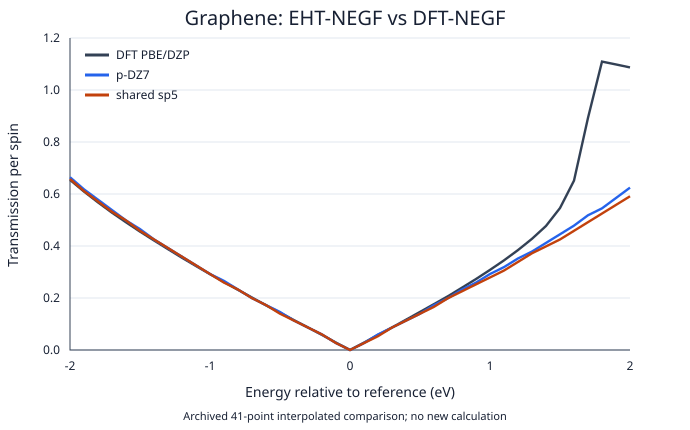

# Extended Hückel quantum transport (experimental)

The independent Python transport kernel uses the existing PyYAeHMOP real-space overlap and weighted Hückel Hamiltonian, retaining nonorthogonality. Principal-layer folding preserves all retained longitudinal couplings. Retarded surface Green functions are evaluated by iterative decimation; the Caroli trace uses energy-dependent couplings zS-H. Transmission is per spin, averaged over transverse k. No SIESTA, TBtrans, native YAeHMOP or DFT input is needed for prediction.

## Graphene example

The static [CSV](graphene_comparison.csv) contains 41 points sampled by linear interpolation from the existing LCCMat calculations (not new GitHub computations). DFT uses its reported energy reference, EHT uses its Dirac energy; a rigorous common alignment remains to be validated. The DFT endpoint values use nearest endpoint extension (original midpoint energy grid). The EHT runs used 301 transverse k points, 401 energies, eta=1e-5 eV, 11 Å cutoff, and 16 workers; DFT PBE/DZP used 1201 k points, 2000 energies, 300 Ry, zero bias. EHT uses a pristine rectangular four-carbon cell (16 orbitals), folded into a principal layer; DFT used an eight-carbon electrode and 32-carbon device. PBS jobs 62836 and 62837 generated the EHT data. The two methods agree closely near the Dirac point but differ above +1 eV, particularly above +1.5 eV. This is a preliminary benchmark, not a converged quantitative validation.

## Which bands were fitted?

Both frozen parameter sets were fitted to **two frontier bands (valence and conduction)**, not four, six or eight. The p-DZ7 C2DB PBE model has seven active parameters, trained on 37 nodes and evaluated at 361 nodes using interpolation of the same external reference, RMSE 0.32230993 eV. The shared sp5 PySCF/GTH-SZV PBE model has five parameters jointly fitted to two bands per material (graphene, T-graphene, net-C), graphene training RMSE 0.16831147 eV. The separate individual graphene sp5 fit (0.16569896 eV) is not the shared model used here. These RMSEs use different DFT references and must not be ranked directly. No transmission data was used to adjust these parameters. The full EHT Hamiltonian has four angular orbitals per atom; p-DZ7 contracts two radial p functions, not seven bands. The earlier independent SIESTA EHT-3 trial used four folded frontier bands and is not the model recommended here.

Frozen parameter provenance: [BandFit best results](https://github.com/tromer-unb/yaehmop-bandfit/blob/main/docs/BEST_RESULTS.md) and [metrics](https://github.com/tromer-unb/yaehmop-bandfit/blob/main/examples/best_results/metrics.json).

## Run locally (explicit opt-in)

From repository root, install with pip install -e ".[plots]" and run:

    OPENBLAS_NUM_THREADS=1 OMP_NUM_THREADS=1 python -m pyaehmop.graphene_transport --model pdz7 --nk 301 --ne 401 --workers 4 --output results/pdz7

Use --model sp5 for the shared parameters. Add --reference PATH for an optional aligned two-column DFT curve. No DFT reference is required. The static SVG is viewable without executing anything. The generic Python API is pyaehmop.transport.realspace, principal_layers, transmission and spectrum. Current scope: coherent, spin-degenerate, identical periodic leads and a pristine central principal layer. Defects, dissimilar leads, spin/SOC, finite-bias self-consistency and GUI integration are not implemented. No automatic CI or heavy runs are added.

## References

- R. Hoffmann, J. Chem. Phys. 39, 1397 (1963), https://doi.org/10.1063/1.1734456.
- M. P. López Sancho et al., J. Phys. F 15, 851 (1985), https://doi.org/10.1088/0305-4608/15/4/009.
- C. Caroli et al., J. Phys. C 4, 916 (1971), https://doi.org/10.1088/0022-3719/4/8/018.
- M. Brandbyge et al., Phys. Rev. B 65, 165401 (2002), https://doi.org/10.1103/PhysRevB.65.165401.
- N. Papior et al., Comput. Phys. Commun. 212, 8–24 (2017), https://doi.org/10.1016/j.cpc.2016.09.022.
